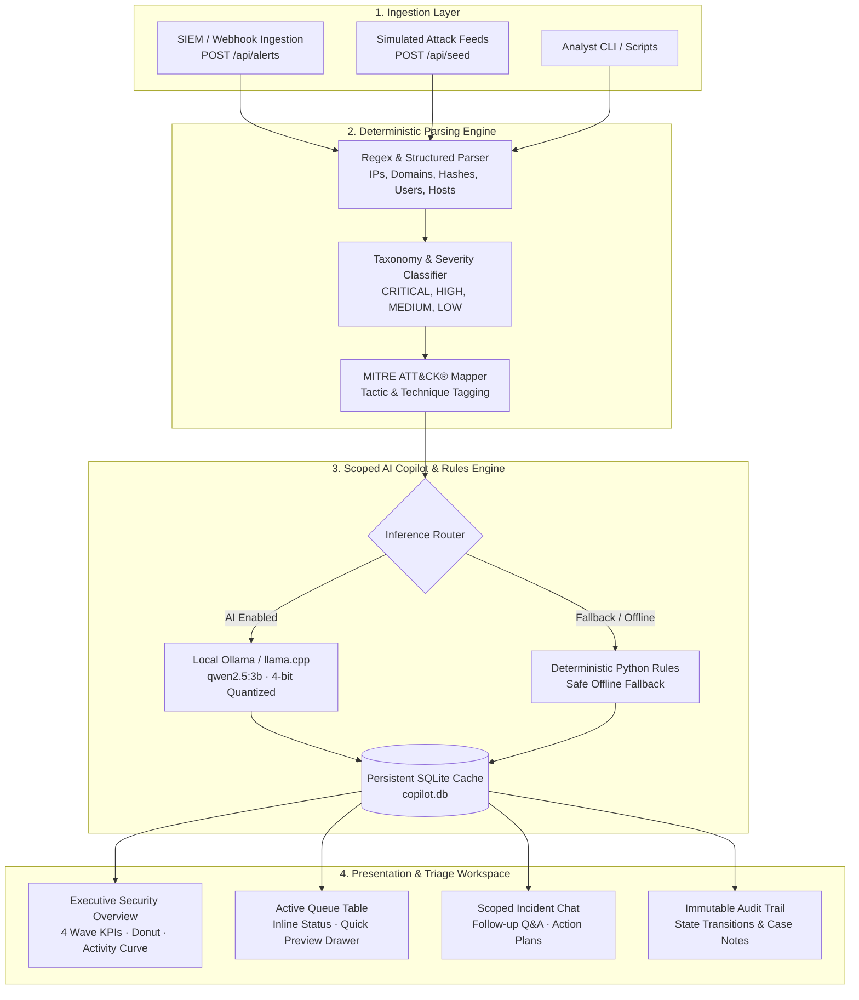
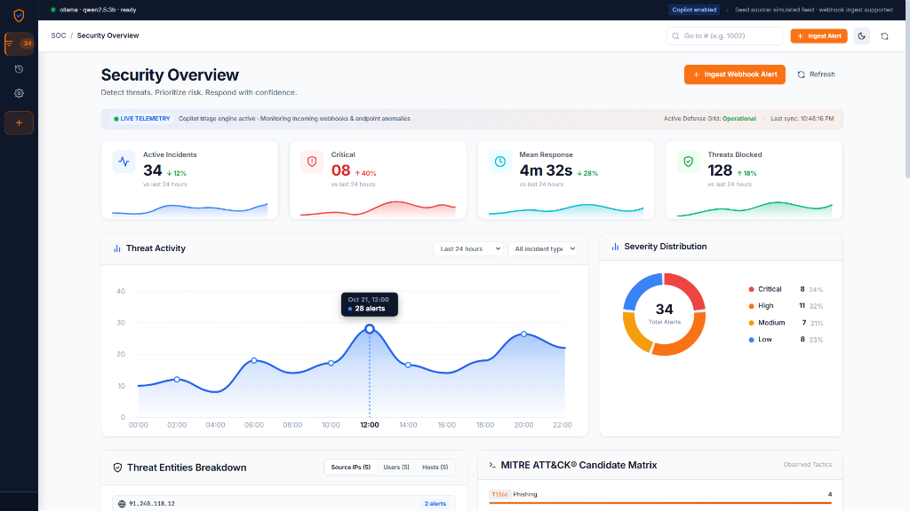
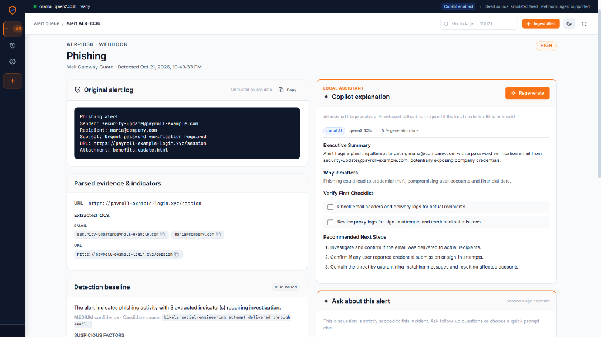
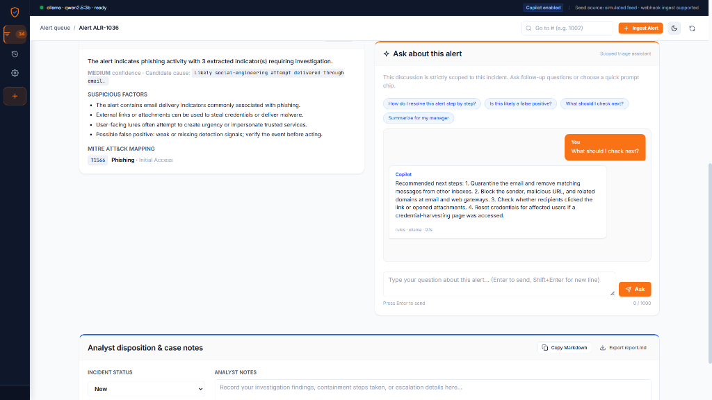
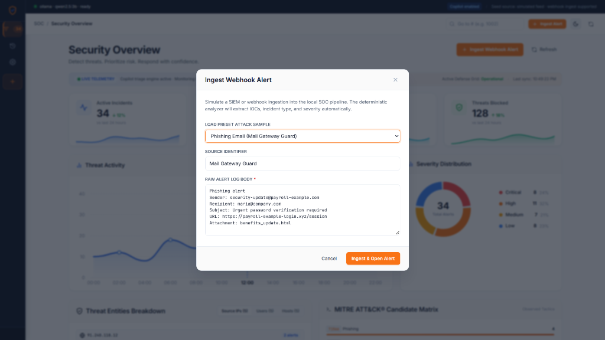
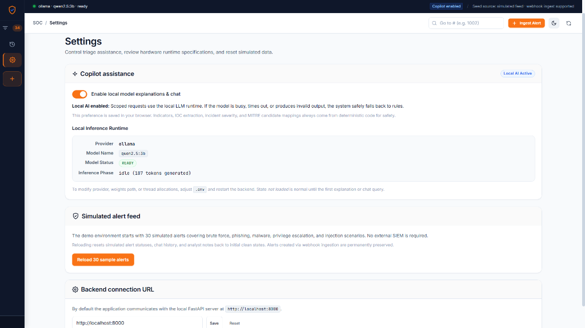

# 🛡️ Local SOC Incident-Response Copilot

[](https://python.org)
[](https://fastapi.tiangolo.com)
[](https://developer.mozilla.org)
[](https://ollama.ai)
[](#security--privacy-guarantee)
[](LICENSE)

An enterprise-grade, **local-first, air-gapped Security Operations Center (SOC) Incident-Response Copilot**. It combines instant deterministic telemetry parsing with on-device Large Language Model (LLM) reasoning to eliminate alert fatigue, accelerate triage turnaround, and maintain strict data sovereignty—**zero logs, raw telemetry, or credentials ever leave your infrastructure.**

---

## 📑 Table of Contents

- [Overview](#-overview)
- [System Architecture](#-system-architecture)
- [Dashboard & Features Tour](#-dashboard--features-tour)
- [Key Capabilities](#-key-capabilities)
- [Quick Start Guide](#-quick-start-guide)
- [Hardware & Model Specifications](#-hardware--model-specifications)
- [API Reference](#-api-reference)
- [Repository Structure](#-repository-structure)
- [Security & Privacy Guarantee](#-security--privacy-guarantee)
- [License](#-license)

---

## 🔍 Overview

Modern security teams face overwhelming signal noise and alert fatigue, while cloud-hosted AI tools introduce unacceptable data-leakage and compliance risks when analyzing sensitive corporate security logs.

The **Local SOC Incident-Response Copilot** solves both challenges:
1. **100% Local Inference**: Runs high-speed, local quantized language models (`qwen2.5:3b` or `llama3.2:3b`) via Ollama or llama.cpp directly on CPU/GPU.
2. **Deterministic-First Safety**: Critical indicators of compromise (IOCs), severities, incident types, and MITRE ATT&CK tactics are extracted deterministically with zero hallucination.
3. **Executive Security Command Center**: Real-time telemetry, 4-wave sparkline KPI metrics, smooth bezier threat activity curves, and severity distribution donut charts.
4. **Interactive Triage Workspace**: Inline triage status selectors, slide-over forensic preview drawers, and incident-scoped interactive AI follow-up investigations.

---

## 🏛️ System Architecture



### Architectural Highlights
- **FastAPI Asynchronous Gateway**: Serves clean, documented REST endpoints with CORS and strict Pydantic v2 schemas.
- **SQLite with WAL Mode**: Embedded zero-configuration persistence with write-ahead logging for sub-millisecond query performance.
- **Zero-Dependency Frontend**: Pure HTML5, modern CSS3 (Custom Properties), and vanilla ES6+ JavaScript. No npm, webpack, Node.js, or Vite build steps required.

---

## 📸 Dashboard & Features Tour

### 1. Executive Security Overview Dashboard
The command deck gives analysts immediate operational situational awareness through 4 wave-sparkline KPI cards, an interactive Threat Activity volume curve, a Severity Distribution donut chart, and dynamic Threat Entity extraction.



### 2. Forensic Alert Analysis & Copilot Assessment
Deep forensic breakdown showing untrusted raw telemetry, parsed indicators of compromise (IOC chips), MITRE ATT&CK technique tags, and local copilot explanation complete with an actionable **Verify First Checklist** and **Recommended Next Steps**.



### 3. Incident-Scoped AI Chat Assistant
A dedicated discussion thread strictly scoped to the active incident. Analysts can test hypotheses, request executive summaries, or click prompt chips with zero risk of prompt injection or cross-incident leakage.



### 4. Real-Time Webhook & SIEM Ingestion
Simulate attack scenarios or connect live enterprise SIEM alerts (Elastic, Splunk, Wazuh, Cloudflare WAF, CrowdStrike EDR) directly into the deterministic ingestion pipeline.



### 5. Local Inference Engine & Hardware Settings
Review hardware runtime metrics, switch between Local AI and deterministic Rules-Only modes, test backend connectivity, and reset simulated benchmark data.



---

## ⚡ Key Capabilities

| Feature | Description | Benefit |
| :--- | :--- | :--- |
| **Executive Wave KPIs** | Active Incidents, Critical, Mean Response Time, and Threats Blocked with live area sparklines. | High-visibility executive metrics with 24h trend deltas. |
| **Threat Activity Curve** | Smooth cubic bezier area curve with 24-hour peak markers and dark floating tooltips. | Instant visualization of attack surges and incident velocity. |
| **Severity Donut Ring** | Multi-segment SVG donut chart with center count (`32 Total Alerts`) and interactive legend. | 1-click filtering of the entire alert queue by severity. |
| **Threat Entities Breakdown** | Auto-aggregates Top Attacking IPs, Targeted Users, and Impacted Hosts. | Isolate repeat adversary infrastructure with a single click. |
| **MITRE ATT&CK® Matrix** | Maps telemetry to tactical candidate techniques (`T1110.001`, `T1566.002`, `T1059.003`). | Industry-standard classification for compliance and detection engineering. |
| **Quick Triage Drawer** | Right slide-over panel with raw payloads, IOCs, and AI summary. | Review forensics without losing your place in the alert queue. |
| **Inline Status Triaging** | Interactive `<select>` in each table row to mark `New`, `In progress`, or `Closed`. | Zero-click status updating that immediately logs to audit history. |
| **Dark / Light Command Center** | One-click theme toggle between Clean Enterprise Light and Cyber Dark Command Center. | Ergonomic interface optimized for 24/7 dark SOC environments. |

---

## 🚀 Quick Start Guide

### Prerequisites
- **Python**: 3.10, 3.11, or 3.12 installed.
- **Ollama** (Recommended for local AI): Download from [ollama.ai](https://ollama.ai).
  ```bash
  ollama pull qwen2.5:3b
  ```

---

### One-Click Launch (Windows)

Simply double-click:
```cmd
start.bat
```
This launcher automatically initializes the Python virtual environment, installs backend requirements, launches the FastAPI server on port `8000`, starts the static HTTP server on port `5173`, and opens the dashboard in your default browser.

To safely shut down all services:
```cmd
stop.bat
```

---

### Manual Launch (PowerShell / Windows)

1. **Clone the repository**:
   ```bash
   git clone https://github.com/prem-2323/genaiHCL-PRE.git
   cd genaiHCL-PRE
   ```

2. **Set up Python environment**:
   ```powershell
   python -m venv .venv
   .\.venv\Scripts\Activate.ps1
   pip install -r backend/requirements.txt
   ```

3. **Start the FastAPI backend**:
   ```powershell
   $env:PYTHONPATH = "backend"
   python -m uvicorn app.main:app --host 127.0.0.1 --port 8000 --reload
   ```

4. **Serve the frontend** (in a separate terminal):
   ```powershell
   python -m http.server 5173 --directory HTMLfront
   ```

5. **Open Dashboard**:
   Navigate to **`http://localhost:5173`** in your browser.

---

### Manual Launch (Linux / macOS)

```bash
# 1. Clone & enter repository
git clone https://github.com/prem-2323/genaiHCL-PRE.git
cd genaiHCL-PRE

# 2. Virtual environment & dependencies
python3 -m venv .venv
source .venv/bin/activate
pip install -r backend/requirements.txt

# 3. Start Backend
PYTHONPATH=backend python3 -m uvicorn app.main:app --host 127.0.0.1 --port 8000 &

# 4. Serve Frontend
python3 -m http.server 5173 --directory HTMLfront &

# 5. Open browser
open http://localhost:5173  # macOS
xdg-open http://localhost:5173  # Linux
```

---

## 🧠 Hardware & Model Specifications

| Parameter | Specification | Notes |
| :--- | :--- | :--- |
| **Default Model** | `qwen2.5:3b` | Outstanding cybersecurity reasoning, structured JSON formatting, and low latency. |
| **Alternative Models** | `llama3.2:3b`, `phi3:mini`, `mistral:7b` | Configurable in `.env` under `OLLAMA_MODEL`. |
| **RAM Footprint** | ~2.2 GB VRAM or System RAM | Runs comfortably on standard laptops without dedicated GPUs. |
| **Inference Time** | 1.8s – 5.2s per explanation | Streaming progress indicator displayed live in header. |
| **Fallback Mode** | Python Rule-Based Classifier | Instantly active if Ollama is not installed or offline. |

---

## 🔌 API Reference

### Health & Telemetry
- `GET /health` — Returns local model status, inference engine health, and active token generation stats.

### Alert Operations
- `GET /api/alerts` — Query alert queue with pagination, severity (`CRITICAL`, `HIGH`, `MEDIUM`, `LOW`), status (`New`, `In progress`, `Closed`), and full-text search (`q=...`).
- `POST /api/alerts` — Ingest raw security webhook or SIEM syslog entry:
  ```json
  {
    "raw_alert": "Failed login detected\nUser: admin\nSource IP: 185.199.111.45",
    "source": "Edge Firewall / SSH Monitor"
  }
  ```
- `GET /api/alerts/{id}` — Retrieve alert forensics, extracted IOCs, and baseline analysis.
- `PATCH /api/alerts/{id}/status` — Update alert state (`{"status": "In progress"}`).
- `GET /api/alerts/{id}/notes` & `PUT /api/alerts/{id}/notes` — Read and update analyst disposition notes.
- `GET /api/alerts/{id}/report.md` — Export complete incident investigation as formatted Markdown.

### AI Copilot & Chat
- `POST /api/alerts/{id}/explain` — Generate comprehensive triage explanation with Verify First checklist.
- `POST /api/alerts/{id}/chat` — Submit scoped follow-up inquiry to the LLM.
- `GET /api/alerts/{id}/chat` — Retrieve scoped conversation history for this alert.

### Analytics & Audit
- `GET /api/stats` — Metrics for active queue count, severity breakdown, and 7-day volume timeline.
- `GET /api/history` — Immutable audit log of status changes and archive of closed incidents.
- `POST /api/seed` — Reload 30 baseline simulated attack alerts (SSH brute force, phishing, malware, SQLi).

---

## 📂 Repository Structure

```
genaiHCL-PRE/
├── .env.example             # Configuration template for models, ports, and paths
├── .gitignore               # Strict rules protecting data, secrets, models, and caches
├── README.md                # Comprehensive project documentation
├── start.bat                # Windows one-click automated startup script
├── stop.bat                 # Windows one-click clean shutdown script
├── workflow.md              # Project requirements, evaluation guidelines, and roadmap
│
├── backend/                 # FastAPI Asynchronous Application
│   ├── app/
│   │   ├── main.py          # FastAPI application factory and route registration
│   │   ├── models.py        # Pydantic v2 schemas for alerts, IOCs, and triage plans
│   │   ├── db.py            # SQLite thread-safe store and atomic state machine
│   │   ├── report.py        # Incident markdown report template generator
│   │   ├── seed.py          # 30 realistic simulated security incidents
│   │   ├── llm/
│   │   │   ├── copilot.py   # AI copilot reasoning engine, prompt schemas, and fallbacks
│   │   │   └── providers.py # Ollama, llama.cpp, and mock runtime providers
│   │   └── services/        # Rule-based analyzers and MITRE ATT&CK taxonomy
│   └── requirements.txt     # Backend Python dependencies
│
├── HTMLfront/               # Pure HTML5 / CSS3 / ES6+ Application (Zero Build Tools)
│   ├── index.html           # Single-page application shell
│   ├── assets/              # SVG brand assets and icons
│   ├── css/
│   │   ├── variables.css    # Design tokens, Light palette, and Cyber Command Center dark theme
│   │   ├── base.css         # Typography, reset, and base utilities
│   │   ├── layout.css       # Responsive grid system and sidebar drawer layout
│   │   ├── components.css   # KPI cards, badges, slide-over drawer, and modal dialogs
│   │   ├── pages.css        # Executive Security Overview, wave sparklines, and donut chart
│   │   └── responsive.css   # Breakpoint optimizations (375px to 1440px+)
│   └── js/
│       ├── bundle.js        # Self-contained bundle for direct file:/// and HTTP execution
│       ├── api.js           # Fetch API client with structured error handling
│       ├── utils.js         # SVG icon dictionary and forensic preset samples
│       ├── components/      # Modular UI components (header, sidebar, modal, toast)
│       └── pages/           # View controllers (queue, detail, history, settings)
│
├── docs/                    # Architecture and documentation assets
│   └── images/              # High-resolution UI screenshots for README
│
└── scripts/                 # Operational and testing automation
    ├── check_model.py       # Diagnostic script verifying Ollama model availability
    ├── run_backend.ps1      # PowerShell backend launcher
    ├── run_frontend.ps1     # PowerShell frontend launcher
    └── test_full_stack.py   # Automated end-to-end integration test suite
```

---

## 🔒 Security & Privacy Guarantee

- **Zero External Egress**: No telemetry data, prompt content, or user credentials ever communicate with external cloud APIs.
- **Strict Input Validation**: All ingestion endpoints enforce Pydantic v2 length bounds, sanitization, and structured type constraints.
- **Isolated AI Scope**: The Copilot context window is strictly bounded to the individual alert being reviewed, preventing cross-tenant or cross-incident data bleed.
- **Human-in-the-Loop**: All AI suggestions are explicitly marked as analyst recommendations requiring human approval prior to firewall or identity containment execution.

---

## 📄 License

This project is licensed under the **MIT License** — see the [LICENSE](LICENSE) file for details. Free for academic, enterprise, and personal use.
