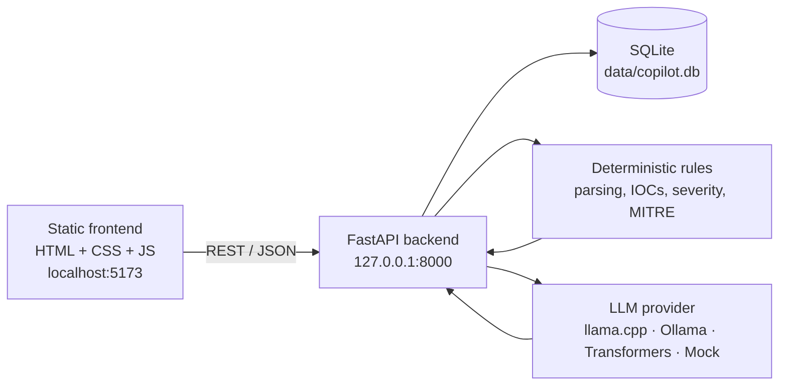

# Local SOC Incident-Response Copilot


A Windows-friendly, local alert-triage workspace for reviewing security alerts, inspecting evidence, asking an offline AI assistant for guidance, and exporting an incident report.

**The copilot recommends actions — it never executes them.** Analyst approval is required before anything happens outside the app.


---

## Table of contents

- [Overview](#overview)
- [Features](#features)
- [How it works](#how-it-works)
- [Tech stack](#tech-stack)
- [Project structure](#project-structure)
- [Requirements](#requirements)
- [Quick start](#quick-start)
- [Enabling local AI](#enabling-local-ai)
- [Configuration](#configuration)
- [API reference](#api-reference)
- [Sample data](#sample-data)
- [Tests and evaluation](#tests-and-evaluation)
- [Security and limitations](#security-and-limitations)
- [Troubleshooting](#troubleshooting)
- [Documentation](#documentation)
- [License](#license)

---

## Overview

The application is a single-user incident-response workspace built around three ideas:

1. **Deterministic analysis first.** Alert parsing, IOC extraction, severity, incident type, and MITRE candidates come from transparent Python rules — not from the language model.
2. **AI only where it helps.** A small local model writes the narrative: summary, why it matters, verification checks, and suggested next steps. Every response is schema-validated, and a rules-based fallback is used when the model is unavailable or malformed.
3. **Local by default.** No cloud API, no telemetry, and no automatic model downloads. Alert data stays in a local SQLite database. The UI references Google Fonts, but falls back to system fonts when offline; remove the font links in `Frontend/index.html` for a zero-external-request setup.

> [!IMPORTANT]
> The demo feed is **simulated**. SQLite is seeded with 30 fictional alerts covering seven incident types, benign maintenance events, and two malicious prompt-injection examples. This is not a SIEM and does not collect live telemetry. Use `POST /api/alerts` to ingest your own alerts.

> [!NOTE]
> This is a local demo, not a production SOC platform. It has no authentication, encryption, role-based access, or hardened deployment controls.

---

## Features

| Area | What it does |
| --- | --- |
| **Alert queue** | Severity/status/type filters, full-text search, pagination, alert-volume chart, jump-to-alert, and webhook ingestion. |
| **Incident detail** | Original alert log, parsed evidence, IOC chips, rule-based baseline, MITRE candidates, and AI guidance. |
| **Local AI explanation** | Summary, why it matters, verify-first checklist, next steps, and an optional false-positive estimate. |
| **Scoped chat** | Follow-up questions about the selected alert only, with server-side scope checks and stored history. |
| **Analyst workflow** | Notes, status transitions (`New` → `In progress` → `Closed`), and an immutable audit trail. |
| **Reporting** | Download a Markdown incident report with evidence, notes, and the selected explanation. |
| **Rules-only mode** | A per-browser switch that bypasses the model for explanations, chat, and reports. |
| **Graceful fallback** | Missing model, timeout, invalid JSON, or grounding failure returns a clearly labeled rules-based result. |
| **Responsive UI** | Pure HTML/CSS/JS frontend for desktop, tablet, and mobile, with no build step. |

---

## How it works



### What uses the model

| Capability | Implementation |
| --- | --- |
| Alert parsing, evidence, IOCs | Deterministic Python |
| Incident type, severity, confidence, MITRE candidates | Rule-based; not independent AI findings |
| Summary, why it matters, verification checks, next steps | Local model with strict JSON/Pydantic validation |
| Model missing, timeout, or invalid output | Rules-based fallback with a visible fallback reason |
| Scoped chat | Server-side question guard; selected alert only; last six stored messages |
| Notes, status audit, cache, reports | SQLite and Python |

Every AI response includes the engine, provider, model, and generation time. `engine=llm, provider=mock` means a deterministic test double, **not real inference**. IOCs are syntactic extracts, not reputation findings, and MITRE candidates are checked against a small bundled catalog.

---

## Tech stack

| Layer | Technology |
| --- | --- |
| Backend | Python 3.11+, FastAPI, Pydantic, Uvicorn |
| Database | SQLite (stdlib `sqlite3`) |
| Frontend | Semantic HTML5, CSS3, vanilla ES6 modules — no framework, no build |
| Local inference | llama.cpp (GGUF), Ollama, or Transformers; `mock` for a model-free demo |
| Testing | pytest, httpx, a 34-case labeled evaluation set |

---

## Project structure

```text
pre/
├── backend/
│   ├── app/
│   │   ├── main.py              # FastAPI routes and app factory
│   │   ├── db.py                # SQLite store, seed, notes, audit, cache
│   │   ├── models.py            # Pydantic request/response models
│   │   ├── seed.py              # 30 simulated alerts
│   │   ├── report.py            # Markdown report renderer
│   │   ├── services/
│   │   │   ├── analyzer.py      # Rule-based triage baseline
│   │   │   └── ioc.py           # IOC extraction
│   │   └── llm/
│   │       ├── providers.py     # Provider selection and Transformers provider
│   │       ├── native.py        # Managed llama.cpp provider
│   │       ├── ollama.py        # Ollama provider
│   │       ├── copilot.py       # Orchestration, cache, fallback
│   │       ├── scope.py         # Chat scope guard
│   │       ├── schema.py        # Structured output schema
│   │       └── mitre.py         # MITRE candidate catalog
│   ├── tests/                   # Backend test suite
│   ├── eval/                    # Labeled regression evaluation
│   ├── requirements-fast.txt    # Lightweight llama.cpp profile
│   └── requirements.txt         # Optional Transformers profile
├── Frontend/                    # Static UI: index.html, css/, js/, assets/
├── HTMLfront/                   # Legacy mirror of the static UI
├── scripts/
│   ├── run_backend.ps1          # Loads .env and starts the API
│   ├── run_frontend.ps1         # Serves the static UI on port 5173
│   ├── setup_fast_model.ps1     # Explicit llama.cpp/model download with SHA-256 checks
│   ├── check_model.py           # Hardware/model smoke test
│   └── test_full_stack.py       # End-to-end API check
├── docs/                        # Design, performance, QA, and progress notes
├── data/                        # SQLite database (created at runtime)
├── .env.example                 # Documented configuration template
├── start.bat / stop.bat         # Windows helper launchers
├── README.md                    # Project overview and reference
├── README.me                    # Identical copy of README.md
└── workflow.md                  # Step-by-step run-and-use runbook
```

---

## Requirements

- **Windows 10/11** (the launchers and memory guidance target Windows; the backend itself is cross-platform).
- **Python 3.11+**.
- **No Node.js or npm required** — the frontend is static.
- **RAM:** 8 GB minimum for the full local-model experience; the fast 0.8B profile is comfortable on a modern laptop.
- **Disk:** roughly 1 GB for the fast llama.cpp runtime + model; about 2 GB for the optional Transformers weights.
- **Internet access** only for installing Python packages and explicitly downloading a model. Runtime inference is offline.

---

## Quick start

> For the complete install-to-triage runbook, including a demo script and troubleshooting, see [workflow.md](workflow.md).

Run the following from the repository root in PowerShell.

### 1. Create a virtual environment and install dependencies

```powershell
python -m venv .venv
.\.venv\Scripts\python.exe -m pip install --upgrade pip
.\.venv\Scripts\python.exe -m pip install -r backend\requirements-fast.txt
```

> Use `requirements-fast.txt` for the llama.cpp or mock profiles. The heavier `requirements.txt` adds Torch and Transformers and is only needed for the optional Transformers profile.

### 2. Create your configuration

```powershell
Copy-Item .env.example .env
```

For the very first run, the simplest option is a model-free demo. Set this in `.env`:

```dotenv
LLM_PROVIDER=mock
```

### 3. Start the backend

```powershell
.\scripts\run_backend.ps1
```

The API starts on `http://127.0.0.1:8000`. Check it at:

- Health: <http://127.0.0.1:8000/health>
- Interactive API docs: <http://127.0.0.1:8000/docs>

### 4. Serve the frontend

In a second terminal, from the repository root:

```powershell
.\scripts\run_frontend.ps1
```

Or serve the static files directly:

```powershell
Set-Location Frontend
..\.venv\Scripts\python.exe -m http.server 5173 --bind 127.0.0.1
```

### 5. Open the app

Go to **<http://localhost:5173>** and try alert `1002` (or `ALR-1002`).

> Use `localhost:5173`, not `127.0.0.1:5173`. The backend deliberately allows only the exact CORS origin `http://localhost:5173`.

To stop everything, press `Ctrl+C` in both terminals, or run `.\stop.bat`.

---

## Enabling local AI

The recommended local profile is **Qwen3.5-0.8B (Q8_0 GGUF)** running on the portable **llama.cpp** CPU runtime. It needs no GPU, Docker, Ollama, Torch, or Node.

### Fast profile (recommended)

```powershell
# Explicit network step: downloads a pinned runtime and model, verifying SHA-256.
.\scripts\setup_fast_model.ps1
```

The script prints the exact paths to add to `.env`:

```dotenv
LLM_PROVIDER=llamacpp
MODEL_PATH=C:\path\to\models\Qwen3.5-0.8B-GGUF\Qwen3.5-0.8B-Q8_0.gguf
LLAMA_SERVER_PATH=C:\path\to\tools\llama-b11755\llama-server.exe
LLAMA_THREADS=4
LLAMA_BATCH_THREADS=8
LLAMA_PORT=8081
MAX_NEW_TOKENS=300
GENERATION_TIMEOUT=90
```

Restart the backend after changing `.env`. The backend starts the model process lazily on the first explanation or chat request and stops it on normal shutdown. The model server is bound to loopback, uses an ephemeral bearer token, disables proxies/redirects, and refuses to attach to an unrelated process on the port.

`/health` reporting `model_status: "not_loaded"` before the first request is normal.

### Ollama

Use an existing local Ollama installation instead:

```powershell
ollama pull qwen2.5:3b
```

```dotenv
LLM_PROVIDER=ollama
OLLAMA_MODEL=qwen2.5:3b
OLLAMA_HOST=127.0.0.1
OLLAMA_PORT=11434
```

### Optional Transformers profile

Use this only if you want the original Python inference path. It is significantly slower on CPU.

```powershell
.\.venv\Scripts\python.exe -m pip install torch==2.13.0 --index-url https://download.pytorch.org/whl/cpu
.\.venv\Scripts\python.exe -m pip install -r backend\requirements.txt
.\.venv\Scripts\python.exe -m pip install "huggingface_hub[cli]"
.\.venv\Scripts\hf.exe download Qwen/Qwen3.5-0.8B --local-dir D:\HCL\models\Qwen3.5-0.8B
```

```dotenv
LLM_PROVIDER=transformers
MODEL_PATH=D:\HCL\models\Qwen3.5-0.8B
MODEL_DISABLE_MMAP=1
MODEL_CPU_INT8=0
TORCH_THREADS=4
MAX_NEW_TOKENS=400
GENERATION_TIMEOUT=300
```

`MODEL_DISABLE_MMAP=1` works around the Windows paging-file error 1455 seen with memory-mapped safetensors. `MODEL_CPU_INT8=1` enables dynamic int8 Linear layers for slower AVX2 CPUs. All model loads are `local_files_only=True`.

### Provider comparison

| Provider | Model | Best for | Notes |
| --- | --- | --- | --- |
| `mock` | None | UI demo, tests, CI | Deterministic output; no inference |
| `llamacpp` | Qwen3.5-0.8B Q8_0 | Fast local CPU use | ~13–22 s step-by-step plans on the reference laptop |
| `ollama` | `qwen2.5:3b` (configurable) | Existing Ollama users | Requires a running Ollama service |
| `transformers` | Qwen3.5-0.8B | Compatibility | PyTorch CPU path; much slower and RAM-heavy |

Response times are observations, not guarantees. See [docs/performance-2026-10-20.md](docs/performance-2026-10-20.md).

---

## Configuration

`.env` is read by `scripts/run_backend.ps1`. Direct `uvicorn` commands require you to export the variables yourself.

| Variable | Default | Purpose |
| --- | --- | --- |
| `LLM_PROVIDER` | `transformers` | `llamacpp`, `ollama`, `transformers`, or `mock` |
| `DB_PATH` | `data/copilot.db` | SQLite database location |
| `MODEL_PATH` | provider-specific | GGUF file (llama.cpp) or safetensors directory (Transformers) |
| `LLAMA_SERVER_PATH` | `llama-server.exe` | llama.cpp runtime executable |
| `LLAMA_PORT` | `8081` | Loopback port for the managed model server |
| `LLAMA_THREADS` | `4` | Generation threads |
| `LLAMA_BATCH_THREADS` | `8` | Prompt/batch threads |
| `OLLAMA_MODEL` | `qwen2.5:3b` | Ollama model name |
| `OLLAMA_HOST` / `OLLAMA_PORT` | `127.0.0.1` / `11434` | Ollama endpoint |
| `MAX_NEW_TOKENS` | `400` (Transformers) | Maximum generated tokens |
| `GENERATION_TIMEOUT` | `300` (Transformers) | Generation deadline in seconds |
| `MODEL_DISABLE_MMAP` | `0` | Set `1` on Windows when safetensors mmap fails |
| `MODEL_CPU_INT8` | `0` | Dynamic int8 Linear layers for the CPU Transformers path |
| `TORCH_THREADS` | `4` | PyTorch CPU threads |
| `HF_HUB_OFFLINE` | `1` | Prevent Hub access at runtime |
| `HF_HUB_DISABLE_TELEMETRY` | `1` | Disable Hugging Face telemetry |
| `DO_NOT_TRACK` | `1` | Disable telemetry hints |

The frontend stores its backend URL and rules-only preference in `localStorage`. Settings → backend URL can point the UI at another local API instance.

---

## API reference

Full interactive documentation is generated at <http://127.0.0.1:8000/docs>.

| Method | Route | Behavior |
| --- | --- | --- |
| `GET` | `/health` | Provider, model, and load state |
| `GET` | `/api/alerts` | Filter/page the queue (`severity`, `status`, `type`, `q`, `page`, `page_size`) |
| `POST` | `/api/alerts` | Ingest an alert through the local webhook |
| `GET` | `/api/alerts/{id}` | Alert plus deterministic baseline |
| `POST` | `/api/alerts/{id}/explain` | Cached explanation; supports `regenerate=true`, `rules_only=true` |
| `GET` | `/api/alerts/{id}/chat` | Stored chat history |
| `POST` | `/api/alerts/{id}/chat` | Ask a scoped follow-up question |
| `PATCH` | `/api/alerts/{id}/status` | Set `New`, `In progress`, or `Closed`; writes an audit entry |
| `GET` / `PUT` | `/api/alerts/{id}/notes` | Read or save analyst notes |
| `GET` | `/api/alerts/{id}/report.md` | Download a Markdown report without starting generation |
| `GET` | `/api/stats` | Counts and alert-volume time series |
| `GET` | `/api/history` | Closed alerts and status changes |
| `POST` | `/api/seed` | Reload the 30 simulated alerts |

Alert IDs accept `1002` or `ALR-1002`. `page_size` is capped at 100, raw alerts at 20,000 characters, questions at 1,000, and notes at 20,000.

### Ingest an alert

```powershell
$body = @{
    raw_alert = "Failed login`nAttempts: 30`nSource IP: 192.0.2.50"
    source    = "Local SIEM"
} | ConvertTo-Json

Invoke-RestMethod http://localhost:8000/api/alerts `
    -Method Post `
    -ContentType application/json `
    -Body $body
```

Reloading samples resets notes, chat, explanations, and statuses for simulated alerts. Webhook alerts are preserved. A request overtaken by a sample reload receives HTTP `409` instead of writing stale output.

---

## Sample data

The seeded feed contains 30 fictional alerts:

- 21 malicious examples across brute force, phishing, malware, impossible travel, port scan, SQL injection, and data exfiltration.
- 7 benign/maintenance examples.
- 2 prompt-injection emails used to test model boundaries.

This is synthetic data for demonstration and regression testing. Nothing is collected from your machine or network.

---

## Tests and evaluation

The backend tests do not need a model or Torch:

```powershell
.\.venv\Scripts\python.exe -m pip install -r backend\requirements-test.txt
.\.venv\Scripts\python.exe -m pytest backend\tests -q
.\.venv\Scripts\python.exe backend\eval\run_eval.py
```

The evaluation set contains 34 manually labeled cases, including nine benign examples. It reports rule classification accuracy and severity agreement. Because the model is intentionally prohibited from deciding those fields, the LLM column is inherited from rules. This is a small synthetic regression set, not a production detection benchmark.

Optional model evaluation (slow; stop the backend first or use another free `LLAMA_PORT`):

```powershell
.\.venv\Scripts\python.exe backend\eval\run_eval.py --llm --provider llamacpp `
    --model-path D:\HCL\models\Qwen3.5-0.8B-GGUF\Qwen3.5-0.8B-Q8_0.gguf `
    --server-path D:\HCL\tools\llama-b11755\llama-server.exe
```

Hardware smoke test with real output and timing:

```powershell
$env:LLAMA_PORT='8082'
.\.venv\Scripts\python.exe scripts\check_model.py `
    --provider llamacpp `
    --server-path D:\HCL\tools\llama-b11755\llama-server.exe `
    --model-path D:\HCL\models\Qwen3.5-0.8B-GGUF\Qwen3.5-0.8B-Q8_0.gguf `
    --alert-id 1002 `
    --question 'How do I resolve this alert step by step?' `
    --runs 2 --timeout 90 --max-new-tokens 300
```

Exit code `0` means real model output, `2` means a rules fallback, and `1` means a loading failure.

---

## Security and limitations

**Security properties**

- Backend binds to `127.0.0.1:8000`; CORS permits only `http://localhost:5173`.
- No cloud API, telemetry, external enrichment, or automatic model downloads at runtime. The UI's only external request is optional Google Fonts; it works offline with system-font fallbacks.
- Alert text is treated as untrusted data and passed through HTML escaping in the frontend.
- Prompt construction, scope refusal, output schema validation, and grounding checks are covered by tests.
- The app has no tool access and cannot execute response actions.

**Important limitations**

- **No authentication or encryption.** Anyone with access to the computer or `data/copilot.db` can read its contents. Do not use real sensitive data in this demo.
- **Simulated feed.** There is no scheduler, SIEM connector, or live telemetry collector. Use the webhook for integrations.
- **Prompt injection is mitigated, not eliminated.** A small model can still be influenced by malicious alert text. Review the two injection samples and test your own adversarial inputs.
- **Narrative quality is not guaranteed.** The 0.8B model can be basic, repetitive, or wrong. Validation enforces shape, not truth. Always verify against original sensor logs.
- **IOCs and MITRE mappings are assistive.** IOCs are syntactic extracts without reputation; MITRE candidates are not a complete ATT&CK analysis.
- **False-positive estimates do not establish safety.**
- **Grounding checks are narrow.** The app retries or falls back if the model invents an email, IP, URL, or hash, but this is not proof of factual accuracy.

---

## Troubleshooting

| Symptom | Fix |
| --- | --- |
| `model_status: "not_loaded"` | Normal before the first explanation/chat request; the model loads lazily. |
| Backend fails to start | Ensure `.venv` exists, dependencies are installed, and port 8000 is free. |
| Frontend cannot reach the API | Start the backend, use <http://localhost:5173>, and check the backend URL in Settings. |
| CORS error | Serve the UI on exactly `http://localhost:5173`; other ports/origins are blocked. |
| Ollama unreachable | Run `ollama serve` and `ollama pull qwen2.5:3b`, then restart the backend. |
| llama.cpp load error | Verify `MODEL_PATH` ends in `.gguf`, `LLAMA_SERVER_PATH` exists, and `LLAMA_PORT` is free. Restart after fixing. |
| Transformers error 1455 | Set `MODEL_DISABLE_MMAP=1`; close memory-heavy apps. |
| Slow generation | Use the step-by-step suggestion chip, close other apps, and keep `LLAMA_THREADS=4` / `LLAMA_BATCH_THREADS=8`. More threads can be slower. |
| Orphan model process after a crash | Stop only the known `llama-server.exe` process or choose another `LLAMA_PORT`. |
| HTTP `409` after seeding | A sample reload replaced the alert while a request was in flight; reload the current alert and retry. |
| Ports already in use | Run `.\stop.bat`, or start Uvicorn/HTTP server on another port (remember CORS). |

---

## Documentation

- [Run and use workflow](workflow.md)
- [Design specification](docs/superpowers/specs/2026-10-20-soc-copilot-design.md)
- [Implementation plan](docs/superpowers/plans/2026-10-20-soc-copilot.md)
- [Implementation progress](docs/implementation-progress.md)
- [Performance notes](docs/performance-2026-10-20.md)
- [Frontend guide](Frontend/README.md)

---

## License

No license file is currently included in this repository. Add a `LICENSE` before redistributing or using the code outside its intended demo/educational context.

---

**Built for local, explainable alert triage. Recommendations only — the analyst decides.**
