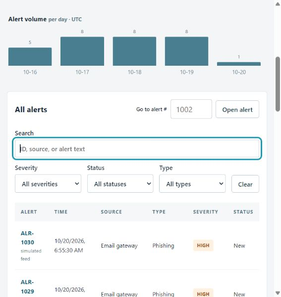
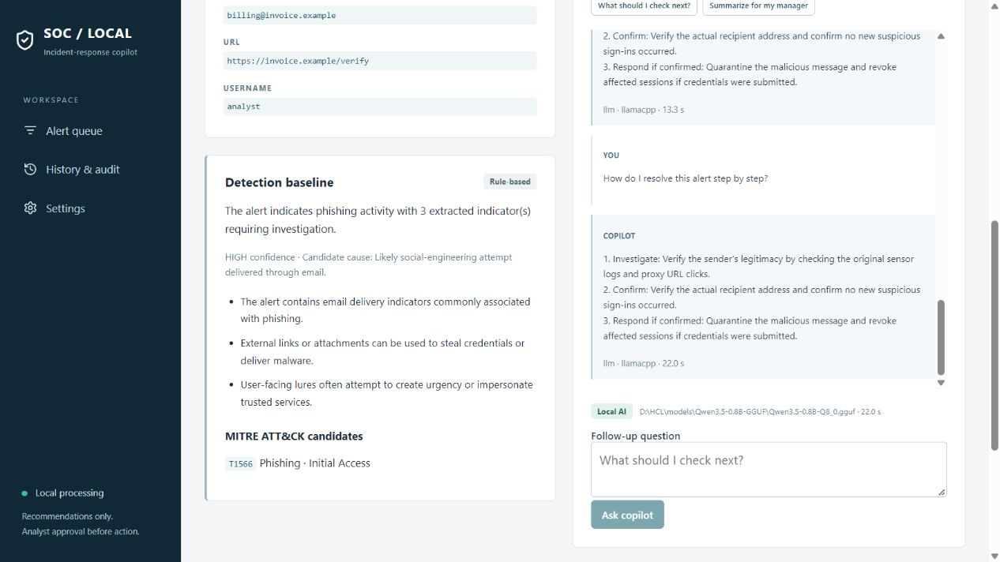

# Workflow — Run and Use the Local SOC Incident-Response Copilot

This is the practical, end-to-end runbook for this project: install it, start it, triage alerts with it, export a report, and shut it down cleanly.

It is written for **Windows + PowerShell**. Commands assume the repository root is the current directory:

```text
C:\Users\premk\Music\project\pre
```

> **What this app is:** a local alert-triage workspace. It parses alerts with deterministic Python rules, optionally adds narrative guidance from a small local model, stores notes/status/history in SQLite, and exports a Markdown report. It never executes a response action.

## TL;DR — already installed?

If `.venv` and `.env` already exist, skip to the two-terminal launch:

```powershell
# Terminal 1
.\scripts\run_backend.ps1

# Terminal 2
.\scripts\run_frontend.ps1
```

Open <http://localhost:5173>. Check `http://localhost:8000/health` if the UI says the backend is unreachable.

The rest of this document explains installation, provider choices, every UI workflow, testing, recovery, and shutdown.

---

## Contents

1. [Prerequisites](#1-prerequisites)
2. [How the pieces fit together](#2-how-the-pieces-fit-together)
3. [One-time installation](#3-one-time-installation)
4. [Choose and configure an AI provider](#4-choose-and-configure-an-ai-provider)
5. [Start the application](#5-start-the-application)
6. [Verify that everything is running](#6-verify-that-everything-is-running)
7. [UI tour](#7-ui-tour)
8. [End-to-end triage workflow](#8-end-to-end-triage-workflow)
9. [Ingest your own alert](#9-ingest-your-own-alert)
10. [Rules-only vs Local AI mode](#10-rules-only-vs-local-ai-mode)
11. [Model operations and performance](#11-model-operations-and-performance)
12. [Verify, test, and evaluate](#12-verify-test-and-evaluate)
13. [Stop, restart, and reset](#13-stop-restart-and-reset)
14. [Data, backup, and restore](#14-data-backup-and-restore)
15. [Troubleshooting](#15-troubleshooting)
16. [Command cheat sheet](#16-command-cheat-sheet)
17. [Five-minute demo script](#17-five-minute-demo-script)
18. [Operating rules](#18-operating-rules)

---

## 1. Prerequisites

### Required

| Requirement | Why | Check |
| --- | --- | --- |
| Windows 10/11 | The launchers and model guidance target Windows | — |
| Python 3.11+ | Backend, scripts, tests | `python --version` |
| PowerShell 5.1+ | Run scripts | `$PSVersionTable.PSVersion` |
| ~500 MB free disk (app only) | Python venv + dependencies | — |
| 8 GB RAM recommended | Browser + backend + optional model | Task Manager |

### Optional

| Requirement | When you need it |
| --- | --- |
| Ollama + `qwen2.5:3b` | Using the `ollama` provider |
| llama.cpp runtime + Qwen3.5-0.8B GGUF | Using the recommended lightweight `llamacpp` provider |
| PyTorch + Transformers + Qwen3.5-0.8B | Using the heavier `transformers` provider |
| Node.js 20+ | Not required. The frontend is static HTML/CSS/JS |

### Ports used

| Port | Service | Availability |
| --- | --- | --- |
| `5173` | Static frontend | Must be free |
| `8000` | FastAPI backend | Must be free |
| `11434` | Ollama (only for `LLM_PROVIDER=ollama`) | Must be reachable; normally held by Ollama |
| `8081` | Managed llama.cpp server (only for `LLM_PROVIDER=llamacpp`) | Must be free before the backend starts |

Check them before starting:

```powershell
Get-NetTCPConnection -LocalPort 8000,5173,8081,11434 -State Listen -ErrorAction SilentlyContinue |
    Select-Object LocalAddress, LocalPort, OwningProcess
```

`8000`, `5173`, and `8081` should be absent. `11434` will appear when Ollama is running, which is expected for the Ollama profile.

---

## 2. How the pieces fit together

```text
┌────────────────────────────────────────────┐
│ Browser                                    │
│ http://localhost:5173                      │
│ Static HTML + CSS + vanilla JS             │
└───────────────────┬────────────────────────┘
                    │ REST/JSON
                    ▼
┌────────────────────────────────────────────┐
│ FastAPI backend                            │
│ http://127.0.0.1:8000                      │
│                                            │
│  • rule-based analyzer                     │
│  • SQLite store                            │
│  • cache, notes, audit, reports            │
│  • scoped chat guard                       │
└───────┬───────────────────┬────────────────┘
        │                   │
        ▼                   ▼
┌───────────────┐   ┌────────────────────────┐
│ SQLite        │   │ LLM provider           │
│ data/         │   │ • mock (no model)      │
│ copilot.db    │   │ • llama.cpp :8081      │
└───────────────┘   │ • Ollama :11434        │
                    │ • Transformers (in-proc)│
                    └────────────────────────┘
```

### The two rules that matter

1. **Rules decide. AI explains.** Incident type, severity, IOCs, evidence, and MITRE candidates always come from deterministic Python. The model only writes narrative guidance.
2. **The model is optional.** If it is missing, slow, or returns invalid JSON, the API returns a clearly labeled rules-based answer instead.

### Why the frontend must be served on port 5173

The backend allows exactly one browser origin:

```text
http://localhost:5173
```

Therefore:

- Do **not** open `Frontend\index.html` directly from disk (`file://`), unless you only want to look at the shell without API data.
- Do **not** use `http://127.0.0.1:5173`; the origin string is different and CORS will block API calls.
- Use `http://localhost:5173`.

---

## 3. One-time installation

### 3.1 Open the project root

```powershell
Set-Location 'C:\Users\premk\Music\project\pre'
```

If the path is different on your machine, use your actual project folder.

### 3.2 Create the virtual environment

```powershell
python -m venv .venv
.\.venv\Scripts\python.exe -m pip install --upgrade pip
```

Check it:

```powershell
.\.venv\Scripts\python.exe --version
```

### 3.3 Install Python dependencies

Choose **one** primary profile.

#### Profile A — Mock / UI demo (no AI model)

```powershell
.\.venv\Scripts\python.exe -m pip install -r backend\requirements-fast.txt
```

#### Profile B — llama.cpp local model (recommended for local AI)

```powershell
.\.venv\Scripts\python.exe -m pip install -r backend\requirements-fast.txt
```

Then follow [section 4.3](#43-provider-c--llamacpp-recommended-for-local-ai).

#### Profile C — Ollama local model

```powershell
.\.venv\Scripts\python.exe -m pip install -r backend\requirements-fast.txt
```

Then install/pull the model in [section 4.2](#42-provider-b--ollama).

#### Profile D — Transformers (optional, heavy)

```powershell
.\.venv\Scripts\python.exe -m pip install torch==2.13.0 --index-url https://download.pytorch.org/whl/cpu
.\.venv\Scripts\python.exe -m pip install -r backend\requirements.txt
```

`requirements.txt` pins Torch and Transformers. The CPU wheel avoids NVIDIA/ROCm packages.

#### Test dependencies (separate, optional)

```powershell
.\.venv\Scripts\python.exe -m pip install -r backend\requirements-test.txt
```

### 3.4 Create `.env`

If `.env` does not exist:

```powershell
Copy-Item .env.example .env
```

If `.env` already exists, keep it. Do not overwrite a working configuration.

Open it:

```powershell
notepad .env
```

`.env` is read automatically by:

- `scripts\run_backend.ps1` — parses the file into the process environment.
- `backend\app\main.py` — `python-dotenv` also loads it when the backend starts from the repo root.

### 3.5 Pick a database location

The default is fine:

```dotenv
DB_PATH=data/copilot.db
```

The folder and database are created automatically. On first start, the database is seeded with 30 simulated alerts.

---

## 4. Choose and configure an AI provider

`LLM_PROVIDER` accepts four values:

| Provider | Model | Download size | Best for |
| --- | --- | --- | --- |
| `mock` | None | 0 | First run, UI demo, CI, no model |
| `llamacpp` | Qwen3.5-0.8B Q8_0 GGUF | ~860 MB total | Fast CPU inference |
| `ollama` | `qwen2.5:3b` by default | Depends on Ollama | Reusing an existing Ollama install |
| `transformers` | Qwen3.5-0.8B safetensors | ~1.75 GB | Compatibility / Python-only path |

### 4.1 Provider A — Mock (fastest first run)

Use this to confirm the UI and API work before downloading a model.

`.env`:

```dotenv
LLM_PROVIDER=mock
DB_PATH=data/copilot.db
```

Characteristics:

- No model process.
- Deterministic mock narrative.
- Responses are labeled `provider=mock`.
- `/health` reports `model_status: "ready"`.
- This is **not real inference**; use it for demos and tests only.

### 4.2 Provider B — Ollama

#### Install Ollama

Install Ollama for Windows from <https://ollama.com/download>, or make sure the `ollama` command is available.

#### Pull the model

```powershell
ollama pull qwen2.5:3b
ollama list
```

#### Make sure Ollama is running

The desktop app usually starts the service automatically. If it is not running:

```powershell
ollama serve
```

Leave that terminal open, or run Ollama as its normal background app.

#### Configure `.env`

```dotenv
LLM_PROVIDER=ollama
OLLAMA_MODEL=qwen2.5:3b
OLLAMA_HOST=127.0.0.1
OLLAMA_PORT=11434
DB_PATH=data/copilot.db
```

Check the service directly:

```powershell
Invoke-RestMethod http://127.0.0.1:11434/api/version
ollama list
```

The backend starts its own provider probe on first use. If Ollama is not installed but is reachable, the provider can still attach to it.

> The current `.env` in this workspace points to Ollama with `qwen2.5:3b`. If that is still running on your machine, this profile needs no model download.

### 4.3 Provider C — llama.cpp (recommended for local AI)

This profile uses a portable CPU runtime and a Q8_0 GGUF model. It does not need Ollama, Docker, Torch, a GPU, or Node.

#### Step 1 — download and verify the runtime + model

```powershell
.\scripts\setup_fast_model.ps1
```

What the script does:

- Downloads the pinned `llama.cpp` Windows CPU runtime (about 24 MB).
- Downloads `Qwen3.5-0.8B-Q8_0.gguf` (about 834 MB).
- Verifies both SHA-256 hashes before use.
- Prints the exact `.env` paths to use.

Default locations (override with `-ToolsRoot` and `-ModelRoot`):

```text
<parent-of-repo>\tools\llama-b11755\llama-server.exe
<parent-of-repo>\models\Qwen3.5-0.8B-GGUF\Qwen3.5-0.8B-Q8_0.gguf
```

Example with custom folders:

```powershell
.\scripts\setup_fast_model.ps1 `
    -ToolsRoot 'D:\HCL\tools' `
    -ModelRoot 'D:\HCL\models\Qwen3.5-0.8B-GGUF'
```

#### Step 2 — configure `.env`

Use the paths printed by the script:

```dotenv
LLM_PROVIDER=llamacpp
MODEL_PATH=D:\HCL\models\Qwen3.5-0.8B-GGUF\Qwen3.5-0.8B-Q8_0.gguf
LLAMA_SERVER_PATH=D:\HCL\tools\llama-b11755\llama-server.exe
LLAMA_PORT=8081
LLAMA_THREADS=4
LLAMA_BATCH_THREADS=8
MAX_NEW_TOKENS=300
GENERATION_TIMEOUT=90
DB_PATH=data/copilot.db
```

Replace the two example paths with the exact ones printed by the setup script.

#### What happens at runtime

- The backend starts the model process **lazily** on the first explanation or chat request.
- The process is hidden and bound to `127.0.0.1`.
- An ephemeral bearer token authenticates the connection.
- Proxies and redirects are disabled.
- The backend refuses to attach to an unrelated server already using `LLAMA_PORT`.
- Normal backend shutdown stops the model child process.
- If the backend is force-killed, the child may survive; see [section 13](#13-stop-restart-and-reset).

### 4.4 Provider D — Transformers (optional)

Use this only if you specifically need the Python PyTorch path. It is much slower and more memory-hungry.

#### Step 1 — install dependencies

```powershell
.\.venv\Scripts\python.exe -m pip install torch==2.13.0 --index-url https://download.pytorch.org/whl/cpu
.\.venv\Scripts\python.exe -m pip install -r backend\requirements.txt
```

#### Step 2 — download the model (explicit network step)

```powershell
.\.venv\Scripts\python.exe -m pip install "huggingface_hub[cli]"
.\.venv\Scripts\hf.exe download Qwen/Qwen3.5-0.8B --local-dir D:\HCL\models\Qwen3.5-0.8B
```

If the download stalls, retry with:

```powershell
$env:HF_HUB_DISABLE_XET='1'
.\.venv\Scripts\hf.exe download Qwen/Qwen3.5-0.8B --local-dir D:\HCL\models\Qwen3.5-0.8B
```

#### Step 3 — configure `.env`

```dotenv
LLM_PROVIDER=transformers
MODEL_PATH=D:\HCL\models\Qwen3.5-0.8B
MODEL_DISABLE_MMAP=1
MODEL_CPU_INT8=0
TORCH_THREADS=4
MAX_NEW_TOKENS=400
GENERATION_TIMEOUT=300
DB_PATH=data/copilot.db
HF_HUB_OFFLINE=1
HF_HUB_DISABLE_TELEMETRY=1
DO_NOT_TRACK=1
```

Notes:

- `MODEL_DISABLE_MMAP=1` works around Windows paging-file error 1455.
- `MODEL_CPU_INT8=1` enables dynamic int8 Linear layers for slower AVX2 CPUs.
- Loading happens once per backend process and can take minutes.
- All model/tokenizer loads use `local_files_only=True`.
- The model is loaded in the backend process; there is no separate model server.

### 4.5 Switching providers

1. Stop the backend (`Ctrl+C` in its terminal).
2. Edit `LLM_PROVIDER` and its related values in `.env`.
3. Start the backend again.
4. Confirm with `http://localhost:8000/health`.

Provider/model changes require a **backend restart**. The browser does not need to be restarted.

---

## 5. Start the application

### Option A — two terminals (recommended)

#### Terminal 1 — backend

From the repository root:

```powershell
.\scripts\run_backend.ps1
```

The script:

- changes to the repo root,
- loads `.env`,
- sets offline/telemetry environment variables,
- runs Uvicorn on `127.0.0.1:8000`.

Expected output includes:

```text
Uvicorn running on http://127.0.0.1:8000
Application startup complete.
```

Leave this terminal open. It is the API and (for llama.cpp/Transformers) the model host.

#### Terminal 2 — frontend

Open a second PowerShell window and run:

```powershell
Set-Location 'C:\Users\premk\Music\project\pre'
.\scripts\run_frontend.ps1
```

This serves the static `Frontend\` folder on `127.0.0.1:5173`.

Expected output:

```text
Serving HTTP on 127.0.0.1 port 5173 (http://127.0.0.1:5173/) ...
```

Leave this terminal open too.

#### Open the app

```text
http://localhost:5173
```

### Option B — `start.bat` one-click launcher

From File Explorer or a terminal:

```powershell
.\start.bat
```

It checks the venv, probes/starts Ollama if available, opens a backend window, opens a frontend window, waits a few seconds, and opens the browser.

This is convenient for the Ollama profile. If you use llama.cpp or Transformers, the manual two-terminal method gives clearer logs.

### Option C — serve the frontend manually

If you prefer not to use the PowerShell script:

```powershell
Set-Location Frontend
..\.venv\Scripts\python.exe -m http.server 5173 --bind 127.0.0.1
```

Then open `http://localhost:5173`.

### Do not start the frontend with a different origin

The backend CORS allow-list contains only:

```text
http://localhost:5173
```

Serving on port `5174`, `8080`, or opening the file directly will cause API requests to fail with a CORS/network error. If you must use another port, update the allowed origin in `backend\app\main.py` and restart the backend.

---

## 6. Verify that everything is running

Run these checks in a third terminal.

### 6.1 Backend health

```powershell
Invoke-RestMethod http://localhost:8000/health | ConvertTo-Json -Depth 4
```

Expected shape:

```json
{
  "status": "ok",
  "provider": "ollama",
  "model": "qwen2.5:3b",
  "model_status": "ready",
  "model_error": null,
  "generation_progress": {
    "phase": "idle",
    "input_tokens": 0,
    "generated_tokens": 0
  }
}
```

`model_status` values:

| Value | Meaning |
| --- | --- |
| `not_loaded` | Model has not been requested yet. Normal for llama.cpp/Transformers. |
| `loading` | Model is starting/loading. |
| `ready` | Model is usable. |
| `error` | Load or runtime failure; inspect `model_error` and backend logs. |

For `mock`, `ready` is immediate.

### 6.2 API documentation

```powershell
Start-Process http://localhost:8000/docs
```

The generated Swagger UI lists every endpoint and lets you try requests.

### 6.3 Frontend

```powershell
(Invoke-WebRequest http://localhost:5173 -UseBasicParsing).StatusCode
```

Expected: `200`.

### 6.4 UI indicators

Open `http://localhost:5173` and confirm:

- The top status ribbon says something like `ollama · qwen2.5:3b · ready` or `llamacpp · ... · not loaded`.
- The green dot is visible in the sidebar footer (`Local processing`).
- The Alert queue loads without a connection banner.
- Settings → Local Inference Runtime shows provider, model, and status.

The header polls `/health` every 5 seconds, so status changes appear without a manual refresh.

---

## 7. UI tour

| Area | How to reach it | What it is for |
| --- | --- | --- |
| **Alert queue** | Sidebar → Alert queue, or `#/` | Triage stats, filters, search, alert table, ingestion |
| **Incident detail** | Click an alert, use `Go to #`, or `#/alerts/1002` | Evidence, IOC review, AI explanation, chat, notes, report |
| **History & audit** | Sidebar → History & audit | Status-change log and closed-alert archive |
| **Settings** | Sidebar → Settings | AI/rules toggle, runtime health, backend URL, sample reload |
| **System ribbon** | Top bar | Provider/model/status, mode badge, last health poll |
| **Global ingest** | Sidebar → Ingest Webhook Alert, or header → Ingest Alert | Paste a raw alert and create a webhook alert from any page |

### Routes

```text
#/                     Alert queue
#/alerts/1002          Alert detail (ALR-1002)
#/history              History and audit
#/settings             Settings
```

### What is browser-local

These preferences are stored in `localStorage`, not in SQLite:

- `soc-rules-only` — rules-only vs local AI mode.
- `soc-api-base` — backend URL (default `http://localhost:8000`).
- `soc-sidebar-collapsed` — sidebar state.

Clearing browser site data resets these preferences.

---

## 8. End-to-end triage workflow

This is the main operational loop. Follow it top to bottom for each alert.

### Step 1 — Start at the Alert queue

You see:

- **Open Alerts**, **Critical**, **High**, **Medium**, **Low** counters.
- **Detection mix** — clickable incident-type pills with counts.
- **Alert volume per day · UTC** — a small bar chart.
- **All alerts** table with Alert, Time, Source, Type, Severity, and Status.
- Pagination, 20 alerts per page by default.



### Step 2 — Filter and search

Use one or more of:

- **Search** — matches alert ID, source, or raw alert text. Debounced by 300 ms.
- **Severity** — `CRITICAL`, `HIGH`, `MEDIUM`, `LOW`.
- **Status** — `New`, `In progress`, `Closed`.
- **Type** — incident categories from the current stats.
- **Clear** — resets all filters.
- **Detection mix pill** — click a category to filter; click again to clear.

Search and filters reset pagination to page 1.

### Step 3 — Open an alert

Three ways:

1. Click a row in the table.
2. Type a number in **Go to #** (for example `1002` or `ALR-1002`) and press **Open**.
3. Use the header search field and press Enter.

The detail page opens at `#/alerts/<id>`.

### Step 4 — Review the deterministic evidence first

Read the left column before trusting any AI text.

| Panel | What to check |
| --- | --- |
| **Original alert log** | The raw, untrusted source text. Use **Copy** if you need it elsewhere. |
| **Parsed evidence & indicators** | Key/value fields extracted from the alert, plus IOC chips grouped by type. Each IOC has a copy button. |
| **Detection baseline** | Rule-based incident type, severity, confidence, candidate cause, suspicious factors, and MITRE ATT&CK candidates. |

Remember:

- IOCs are **syntactic extracts**, not reputation verdicts.
- MITRE candidates are matched against a small bundled catalog; they are not a full ATT&CK analysis.
- The baseline is rule-based, not an independent AI finding.

### Step 5 — Generate the Copilot explanation

In the right column, click **Explain alert**.

What happens:

1. The browser calls `POST /api/alerts/{id}/explain`.
2. If a cached result exists for the current provider/model/rules mode, it is returned immediately and marked **Cached**.
3. Otherwise the local model generates a strict JSON narrative.
4. If generation fails, times out, or returns invalid output, the response falls back to rules and shows **Fallback to deterministic rules** with a reason.

While generating:

- A live timer counts seconds.
- CPU generation commonly takes 10–30+ seconds; the first call may also include model load.
- You can keep reviewing evidence or notes; the request runs in the backend thread pool.

When it completes, read:

| Section | Meaning |
| --- | --- |
| **Executive Summary** | Short narrative of what the alert appears to be. |
| **Why it matters** | Potential impact, explicitly unconfirmed. |
| **Verify First Checklist** | Interactive checkboxes. Checking them is only a UI aid; it does not persist. |
| **Recommended Next Steps** | Suggested analyst actions. Nothing is executed. |
| **False-Positive Likelihood** | Optional `LOW`/`MEDIUM`/`HIGH` estimate with a reason. |

Badges and warnings:

- **Local AI** — real local model output (`engine=llm`).
- **Rule-based** — deterministic fallback.
- **Mock output** — `provider=mock`; not real inference.
- **Cached** — previous valid result reused.
- **Fallback to deterministic rules** — the model was unavailable, slow, or invalid.
- **Context shortened** — the model received a bounded version of a long alert; the original remains on the left.

Clicking **Regenerate** forces a fresh generation and replaces the cache entry.



### Step 6 — Ask scoped follow-up questions

Use the **Ask about this alert** panel below the explanation.

Ways to ask:

- Click a suggestion chip:
  - `How do I resolve this alert step by step?`
  - `Is this likely a false positive?`
  - `What should I check next?`
  - `Summarize for my manager`
- Type a question (3–1,000 characters).
- Press **Enter** to send, **Shift+Enter** for a new line.

Behavior:

- The chat is scoped to the selected alert.
- General security education, questions about other alerts, and mixed/uncertain requests are refused by the server-side scope guard.
- The backend uses the last six stored messages as context.
- Stored history returns the latest 100 messages when the page reloads.
- The answer bubble shows engine, provider, and generation time.

If you need a compact action plan, the step-by-step question uses a shorter native plan format (Investigate / Confirm / Respond if confirmed) and is usually faster than a full explanation.

### Step 7 — Record status and notes

At the bottom of the detail page, use **Analyst disposition & case notes**:

1. Set **Incident Status** to `New`, `In progress`, or `Closed`.
   - The change saves immediately.
   - A toast confirms it.
   - An immutable audit entry is written.
   - Selecting the same status again does not create a duplicate entry.
2. Write notes in the textarea (up to 20,000 characters).
   - The indicator changes from **Saved** to **Unsaved changes**.
   - Click **Save notes** to persist.
   - Notes survive page reloads and backend restarts.

Recommended note contents:

- What you verified and where (sensor/log source).
- What you ruled out.
- What you changed or contained.
- Who you escalated to.
- Why you closed the alert.

### Step 8 — Export the report

Two buttons:

| Button | Action |
| --- | --- |
| **Copy Markdown** | Fetches the report and copies it to the clipboard. |
| **Export report.md** | Downloads `ALR-<id>.md`. |

The report is built from:

- Alert metadata and raw alert.
- Deterministic baseline, evidence, IOCs, and MITRE candidates.
- Analyst notes.
- The saved explanation for the current mode (`rules_only` or local AI), if one exists.

Report generation does **not** start model inference. If no explanation has been generated yet, the report contains deterministic content only.

### Step 9 — Confirm the audit trail

Go to **History & audit**:

- **Status changes audit trail** — previous status → new status, with timestamp, newest first.
- **Closed alerts** — archive of `Closed` alerts with links back to detail.

> **A fresh database shows 0 records here.** All 30 seeded alerts start as `New`, so there is nothing to audit until you change at least one status. Open an alert, set it to `In progress` or `Closed`, then return to this page. The empty state now links directly to alert `1002` to make this quick to test.

Click an alert ID or row to reopen it.

### Step 10 — Repeat

For the next alert, return to **Alert queue**, clear filters if needed, and repeat steps 1–9.

---

## 9. Ingest your own alert

### 9.1 Through the UI

1. Open **Alert queue**.
2. Click **Ingest Webhook Alert** in the left sidebar (or **Ingest Alert** in the header, or the same button on the queue page).
3. Optionally choose a **Load Preset Attack Sample**.
4. Set **Source Identifier** (default `Local SIEM Webhook`, max 150 characters).
5. Paste the raw alert into **Raw Alert Log Body** (5–20,000 characters).
6. Click **Ingest & Open Alert**.

The backend:

1. Creates a new alert with `origin=webhook`.
2. Assigns the next numeric ID (for example `ALR-1031`).
3. Runs the deterministic analyzer immediately.
4. Stores the baseline and opens the detail page.

Webhook alerts are **preserved** when you reload the simulated feed.

> Ingesting an alert adds it to the **Alert queue**. It does **not** create an audit-history entry. The **History & audit** page only records status changes and closed alerts, so it stays empty until you change a status.

### 9.2 Through the API (PowerShell)

```powershell
$body = @{
    raw_alert = @"
Failed login detected
User: admin
Source IP: 192.0.2.50
Attempts: 30
Service: SSH
"@
    source = "Local SIEM"
} | ConvertTo-Json

$alert = Invoke-RestMethod http://localhost:8000/api/alerts `
    -Method Post `
    -ContentType application/json `
    -Body $body

$alert | ConvertTo-Json -Depth 4
```

Then open:

```text
http://localhost:5173/#/alerts/$($alert.id)
```

Optional fields:

```json
{
  "raw_alert": "text...",
  "source": "Edge Firewall",
  "timestamp": "2026-10-21T10:00:00Z"
}
```

If `timestamp` is omitted, the current UTC time is used.

### 9.3 Through the API (curl.exe)

```powershell
$payload = '{"raw_alert":"Port scan from 192.0.2.50 against 198.51.100.8","source":"Network sensor"}'
curl.exe -X POST http://localhost:8000/api/alerts `
  -H "Content-Type: application/json" `
  --data-binary $payload
```

### 9.4 Ingest limits and behavior

| Rule | Value |
| --- | --- |
| Raw alert minimum | 5 characters |
| Raw alert maximum | 20,000 characters |
| Source minimum/maximum | 1 / 150 characters |
| ID | Auto-incremented numeric ID, displayed as `ALR-<id>` |
| Origin | `webhook` |
| Duplicate detection | None |
| Baseline analysis | Automatic and rule-based |

### 9.5 The 409 race

If `/api/seed` replaces simulated alerts while an explanation/chat request for one of them is in flight, the backend returns HTTP `409` instead of writing stale output into the recreated alert.

What to do:

1. Reload the alert page.
2. Run the request again.

Webhook alerts are unaffected by seeding.

### 9.6 Programmatic triage example

You can run the same workflow from PowerShell without the UI:

```powershell
$id = 1002
$base = 'http://localhost:8000'

# 1. Read the alert and rule-based baseline
$alert = Invoke-RestMethod "$base/api/alerts/$id"
$alert.baseline | ConvertTo-Json -Depth 5

# 2. Generate an explanation (omit rules_only for local AI)
$explain = Invoke-RestMethod "$base/api/alerts/$id/explain?regenerate=false" -Method Post
$explain | ConvertTo-Json -Depth 5

# 3. Fast rules-only explanation instead (no model wait)
$rules = Invoke-RestMethod "$base/api/alerts/$id/explain?rules_only=true" -Method Post

# 4. Save analyst notes
$notesBody = @{ text = 'Verified the source IP against firewall logs; no successful login.' } | ConvertTo-Json
Invoke-RestMethod "$base/api/alerts/$id/notes" -Method Put `
    -ContentType 'application/json' -Body $notesBody

# 5. Move the case forward and record an audit entry
$statusBody = @{ status = 'In progress' } | ConvertTo-Json
Invoke-RestMethod "$base/api/alerts/$id/status" -Method Patch `
    -ContentType 'application/json' -Body $statusBody

# 6. Download the Markdown report
Invoke-RestMethod "$base/api/alerts/$id/report.md" -OutFile "ALR-$id.md"
```

Interactive equivalent: <http://localhost:8000/docs>.

---

## 10. Rules-only vs Local AI mode

### 10.1 The toggle

Go to **Settings → Copilot assistance**.

- Checkbox **on** (`Enable local model explanations & chat`) → Local AI mode.
- Checkbox **off** → Rules-only mode.

The preference is stored in the browser (`localStorage` key `soc-rules-only`) and applies to:

- Explanations.
- Chat.
- Report export.

The top ribbon shows **Copilot enabled** or **Rules-only mode**.

### 10.2 What rules-only does

- Explanation and chat requests bypass model inference.
- Responses use deterministic Python narrative and are labeled **Rule-based**.
- Report export uses the rules-mode result.
- The model is **not unloaded**; switching back to AI mode reuses the loaded model.

### 10.3 When to use rules-only

- Model is unavailable or too slow.
- You need a reproducible, deterministic explanation.
- You are demonstrating the app without model hardware.
- You want to compare AI narrative against the baseline.

### 10.4 Cache behavior

Cache keys include:

- provider name,
- model name,
- rules-only flag,
- `MAX_NEW_TOKENS`,
- `MODEL_CPU_INT8`.

Rules and AI results have separate cache entries. Changing provider/model creates a new cache namespace.

---

## 11. Model operations and performance

### 11.1 Model lifecycle

| Provider | Start | Stop |
| --- | --- | --- |
| `mock` | Immediate | Nothing to stop |
| `ollama` | Backend probes/starts Ollama if needed | Backend does not normally stop a user-managed Ollama service |
| `llamacpp` | Lazily spawns hidden `llama-server.exe` | Backend shutdown terminates the child |
| `transformers` | Loads weights into the backend process on first use | Backend process exits |

For llama.cpp, these are normal:

- `not_loaded` before first use.
- `loading` during startup.
- `ready` once the server responds.
- `generation_progress.phase = generating` while tokens are produced.

### 11.2 Expected speed

Observations on the reference laptop (Ryzen 7 5825U, CPU only):

| Task | llama.cpp profile |
| --- | --- |
| Step-by-step chat plan | ~13–22 seconds |
| Full explanation | ~27 seconds |
| Model load | a few seconds (warm start) |

Transformers on the same machine took minutes for cold load plus generation. These are observations, not guarantees. CPU load, RAM pressure, prompt length, and output length all matter.

### 11.3 Performance tuning

For llama.cpp:

```dotenv
LLAMA_THREADS=4
LLAMA_BATCH_THREADS=8
MAX_NEW_TOKENS=300
GENERATION_TIMEOUT=90
```

- More threads can be slower on small laptops.
- The step-by-step chip produces a shorter, faster output than a full explanation.
- Close other memory-heavy applications.
- Keep the backend warm: the first call includes model load.
- Long alerts may be truncated for the model; the original remains in SQLite/UI.

For Transformers:

```dotenv
TORCH_THREADS=4
MODEL_DISABLE_MMAP=1
MAX_NEW_TOKENS=400
GENERATION_TIMEOUT=300
```

- `MODEL_DISABLE_MMAP=1` avoids Windows error 1455.
- `MODEL_CPU_INT8=1` can help on older AVX2 CPUs, but may change output quality.
- Loading has a high transient RAM peak.

### 11.4 Model health commands

```powershell
Invoke-RestMethod http://localhost:8000/health | ConvertTo-Json -Depth 4
```

For Ollama separately:

```powershell
Invoke-RestMethod http://127.0.0.1:11434/api/version
ollama list
```

For llama.cpp, check the backend log or the health endpoint. Do not manually start a second `llama-server.exe` on the same port.

---

## 12. Verify, test, and evaluate

### 12.1 Install test dependencies

```powershell
.\.venv\Scripts\python.exe -m pip install -r backend\requirements-test.txt
```

### 12.2 Run the backend test suite

```powershell
.\.venv\Scripts\python.exe -m pytest backend\tests -q
```

Tests do not require a model or Torch.

### 12.3 Run the rules evaluation

```powershell
.\.venv\Scripts\python.exe backend\eval\run_eval.py
```

Expected on the bundled set:

```text
Cases: 34; benign: 9
Classification accuracy        |         100.0% | inherited from rules
Severity agreement             |         100.0% | inherited from rules
```

This is a small synthetic regression set, not a production detection benchmark.

### 12.4 Evaluate with a real model (optional, slow)

Stop the backend first or choose a free `LLAMA_PORT`.

```powershell
$env:LLAMA_PORT='8082'
.\.venv\Scripts\python.exe backend\eval\run_eval.py --llm --provider llamacpp `
    --model-path D:\HCL\models\Qwen3.5-0.8B-GGUF\Qwen3.5-0.8B-Q8_0.gguf `
    --server-path D:\HCL\tools\llama-b11755\llama-server.exe
```

For Transformers:

```powershell
.\.venv\Scripts\python.exe backend\eval\run_eval.py --llm --provider transformers `
    --model-path D:\HCL\models\Qwen3.5-0.8B
```

### 12.5 Hardware/model smoke check

This loads the model outside the API and prints load time, response, generation time, and memory.

llama.cpp:

```powershell
$env:LLAMA_PORT='8082'
.\.venv\Scripts\python.exe scripts\check_model.py `
    --provider llamacpp `
    --server-path D:\HCL\tools\llama-b11755\llama-server.exe `
    --model-path D:\HCL\models\Qwen3.5-0.8B-GGUF\Qwen3.5-0.8B-Q8_0.gguf `
    --alert-id 1002 `
    --question 'How do I resolve this alert step by step?' `
    --runs 2 --timeout 90 --max-new-tokens 300
```

Transformers:

```powershell
.\.venv\Scripts\python.exe scripts\check_model.py `
    --provider transformers `
    --model-path D:\HCL\models\Qwen3.5-0.8B `
    --cpu-int8 --disable-mmap --timeout 300
```

Exit codes:

| Code | Meaning |
| --- | --- |
| `0` | Real model output produced |
| `1` | Model loading failed |
| `2` | Rules fallback was returned |

### 12.6 Full-stack smoke test (optional)

With the backend and frontend running:

```powershell
.\.venv\Scripts\python.exe scripts\test_full_stack.py
```

This script is tailored to the current Ollama setup. It expects:

- frontend on `http://localhost:5173`,
- backend on `http://localhost:8000`,
- `LLM_PROVIDER=ollama` and `OLLAMA_MODEL=qwen2.5:3b`,
- a working model.

It creates one test webhook alert and exercises health, stats, queue, search, ingest, notes, status, explanation, chat, report, and history. Run it against a demo database, not data you care about.

### 12.7 Do not treat passing tests as a security certification

The suite covers rules, API behavior, schema validation, fallbacks, and deterministic guards. It does **not** prove prompt-injection resistance or factual correctness of model output.

---

## 13. Stop, restart, and reset

### 13.1 Normal stop

In each terminal, press:

```text
Ctrl+C
```

Then confirm `Y` if prompted.

### 13.2 `stop.bat`

```powershell
.\stop.bat
```

It finds and kills the processes listening on:

- port `8000` (backend),
- port `5173` (frontend).

It does not stop a separately managed Ollama service.

### 13.3 Restart

1. Stop the backend.
2. Start it again with `.\scripts\run_backend.ps1`.
3. Leave the frontend running unless you changed frontend files.
4. Reload the browser tab if needed.

For `.env` or provider changes, always restart the backend.

### 13.4 Orphan llama.cpp process

If the backend was force-killed, `llama-server.exe` may still hold port `8081`.

Check:

```powershell
Get-NetTCPConnection -LocalPort 8081 -State Listen -ErrorAction SilentlyContinue |
    Select-Object LocalAddress, LocalPort, OwningProcess
```

Find the process:

```powershell
Get-Process llama-server -ErrorAction SilentlyContinue
```

Stop only the known process:

```powershell
Stop-Process -Id <PID> -Force
```

Alternatively, change `LLAMA_PORT` in `.env` and restart the backend.

### 13.5 Reload the simulated feed

UI: **Settings → Simulated alert feed → Reload 30 sample alerts**.

API:

```powershell
Invoke-RestMethod http://localhost:8000/api/seed -Method Post
```

This:

- deletes simulated-feed alerts,
- recreates all 30 samples,
- resets their notes, chat, explanations, and statuses,
- preserves webhook-ingested alerts.

### 13.6 Full reset

Stop the backend first. Then back up (optional) and remove the database:

```powershell
Copy-Item data\copilot.db data\copilot.backup.db -ErrorAction SilentlyContinue
Remove-Item data\copilot.db, data\copilot.db-wal, data\copilot.db-shm -ErrorAction SilentlyContinue
```

Start the backend again. The database is recreated and seeded automatically.

---

## 14. Data, backup, and restore

### 14.1 What is stored where

| Data | Location |
| --- | --- |
| Alerts, baseline analysis | `data/copilot.db` → `alerts` |
| Cached explanations | `data/copilot.db` → `copilot_results` |
| Chat messages | `data/copilot.db` → `chat_messages` |
| Notes | `data/copilot.db` → `notes` |
| Status audit | `data/copilot.db` → `status_history` |
| Browser preferences | Browser `localStorage` |
| Model files | Paths configured in `.env` |
| Reports | Downloaded by the browser; not stored by the app |

### 14.2 Backup

Stop the backend, then copy all SQLite files:

```powershell
Copy-Item data\copilot.db data\copilot.backup.db -Force
Copy-Item data\copilot.db-wal data\copilot.backup.db-wal -ErrorAction SilentlyContinue
Copy-Item data\copilot.db-shm data\copilot.backup.db-shm -ErrorAction SilentlyContinue
```

### 14.3 Restore

With the backend stopped:

```powershell
Copy-Item data\copilot.backup.db data\copilot.db -Force
Remove-Item data\copilot.db-wal, data\copilot.db-shm -ErrorAction SilentlyContinue
```

Start the backend and reload the browser.

### 14.4 Change the database location

Edit `.env`:

```dotenv
DB_PATH=D:\soc-data\copilot.db
```

Restart the backend. The parent folder is created automatically.

### 14.5 No authentication

The app binds to loopback and has no login. Anyone with access to the computer or the database file can read its contents. Do not use real sensitive incident data in this demo.

---

## 15. Troubleshooting

| Symptom | Likely cause | Fix |
| --- | --- | --- |
| `Frontend dependencies not found` | You are running an old launcher | Use `.\scripts\run_frontend.ps1`; Node is not required |
| `Cannot connect to backend` banner | Backend not running or wrong URL | Start `.\scripts\run_backend.ps1`; check Settings → Backend URL |
| CORS error | Frontend served on wrong origin | Use exactly `http://localhost:5173` |
| Port 8000 already in use | Another backend/Uvicorn | `.\stop.bat`, or stop the specific process |
| Port 5173 already in use | Another HTTP server | Stop it or use a different server, then update CORS |
| `model_status: not_loaded` | Model not requested yet | Normal; click **Explain alert** or ask a chat question |
| `model_status: error` | Bad model path/runtime/Ollama | Read `model_error`; verify `.env` paths and restart |
| Ollama unreachable | Service not running | Start Ollama, run `ollama list`, restart backend |
| `qwen2.5:3b` missing | Model not pulled | `ollama pull qwen2.5:3b` |
| llama.cpp: missing GGUF/exe | Paths wrong | Re-run setup script and copy printed paths |
| llama.cpp: port 8081 busy | Orphan/server already running | Stop known `llama-server.exe` or change `LLAMA_PORT` |
| Windows error 1455 | Paging file too small for mmap | Set `MODEL_DISABLE_MMAP=1`; close memory-heavy apps |
| Very slow first answer | Model cold load | Wait; later calls reuse the model |
| Very slow every answer | CPU pressure / too many threads | Close apps; try 4 generation / 8 batch threads |
| Explanation says **Rule-based** | Model unavailable/timeout/invalid or rules-only mode | Check health, disable rules-only, retry |
| Explanation says **Mock output** | `LLM_PROVIDER=mock` | Switch provider and restart |
| Chat refuses question | Scope guard | Ask one question specifically about the selected alert |
| Notes not saved | **Save notes** not clicked | Click Save; watch for the toast |
| Report has no AI text | No explanation generated for that mode | Generate an explanation first, or accept rules-based report |
| HTTP 409 after reloading samples | Sample reload raced an in-flight request | Reload the alert page and retry |
| History page empty | No status changes yet; seeded alerts all start as `New` | This is normal on a fresh database. Change an alert status, then refresh |
| UI shows stale data | Browser cache/old tab | Hard refresh (`Ctrl+F5`) or click the global refresh button |

### Reading backend logs

The backend terminal prints:

- tracebacks for load/inference failures,
- Uvicorn request logs,
- model errors (also exposed in `/health`).

If `model_error` is non-null, fix that before retrying.

### Checking what is listening

```powershell
Get-NetTCPConnection -State Listen |
    Where-Object { $_.LocalPort -in 8000,5173,8081,11434 } |
    Select-Object LocalAddress, LocalPort, OwningProcess
```

Resolve a PID:

```powershell
Get-Process -Id <PID>
```

---

## 16. Command cheat sheet

```powershell
# --- setup ---
python -m venv .venv
.\.venv\Scripts\python.exe -m pip install --upgrade pip
.\.venv\Scripts\python.exe -m pip install -r backend\requirements-fast.txt
Copy-Item .env.example .env

# --- optional local model ---
.\scripts\setup_fast_model.ps1
ollama pull qwen2.5:3b

# --- run ---
.\scripts\run_backend.ps1          # terminal 1
.\scripts\run_frontend.ps1         # terminal 2
.\start.bat                        # or one-click
.\stop.bat                         # stop both ports

# --- verify ---
Invoke-RestMethod http://localhost:8000/health | ConvertTo-Json -Depth 4
(Invoke-WebRequest http://localhost:5173 -UseBasicParsing).StatusCode
Start-Process http://localhost:8000/docs
Start-Process http://localhost:5173

# --- tests ---
.\.venv\Scripts\python.exe -m pip install -r backend\requirements-test.txt
.\.venv\Scripts\python.exe -m pytest backend\tests -q
.\.venv\Scripts\python.exe backend\eval\run_eval.py

# --- data ---
Invoke-RestMethod http://localhost:8000/api/seed -Method Post
Copy-Item data\copilot.db data\copilot.backup.db -Force
```

---

## 17. Five-minute demo script

Use this when showing the project to someone.

### Minute 0 — confirm readiness

```powershell
Invoke-RestMethod http://localhost:8000/health | ConvertTo-Json -Depth 4
```

Say: “Rules do the detection; the local model only writes guidance; nothing is executed.”

### Minute 1 — queue

Open `http://localhost:5173`.

Point out:

- open/critical/high counts,
- detection mix,
- alert volume chart,
- search/filter controls.

Filter to `HIGH` and `New`.

### Minute 2 — brute-force alert `1002`

Open `Go to # 1002`.

Show:

- raw alert,
- parsed evidence and IOC chips,
- rule baseline: brute force, severity, confidence, MITRE candidates.

### Minute 3 — explanation

Click **Explain alert**.

While it generates, say:

- first call may load the model,
- CPU generation can take 10–30+ seconds,
- failures fall back to rules.

Read the summary, why it matters, verify-first checklist, next steps, and false-positive estimate.

### Minute 4 — scoped chat and notes

Click `How do I resolve this alert step by step?`.

Point out the Investigate / Confirm / Respond structure.

Then:

- set status to **In progress**,
- add a note such as “Verified source IP against firewall logs; no successful login”,
- click **Save notes**.

### Minute 5 — report and audit

Click **Export report.md**.

Then open **History & audit** and show the status transition.

Optional contrast: open alert `1022` (benign newsletter) and `1029` (prompt-injection sample), and explain why the rule baseline and scope guard matter.

---

## 18. Operating rules

1. **Treat alert text as untrusted.** It may contain malicious instructions.
2. **Verify before acting.** The model can hallucinate or follow injected text.
3. **Rules are the source of truth for type/severity.** Do not treat AI narrative as a second opinion on classification.
4. **No automatic actions.** The app cannot isolate a host, block an IP, disable a user, or send email.
5. **Keep it local.** Do not expose ports `8000`/`5173` to a network. The app has no authentication.
6. **Use synthetic data for demos.** The seeded feed is fictional.
7. **Export a report before closing an important case.** Reports are not stored server-side.
8. **Back up the SQLite file before a reset.** Removing `data/copilot.db` removes notes, chat, cache, and audit history.

---

**Bottom line:** start the backend, serve the frontend, open `http://localhost:5173`, review the rules first, ask the copilot second, record your decision, export the report, and close the loop in History.
